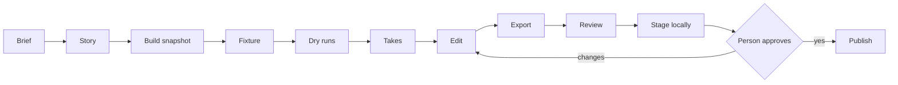

# Agent-directed software demos

## Hello, human

I don't enjoy recording demos by hand, so I handed the job to agents. This is how they do it. 

---

*The rest of this README was written by an AI model (Claude Opus 5.5) from the rules in this repository and the production notes they summarize.*

### Why this is public

Agent-directed software demos is a personal playbook, not software. I built it with AI coding agents for my own use: to make short, honest demo films of my own apps for their GitHub releases and my personal site. Take what's useful. It's unsupported, and I'm not promising fixes.

---

Short, honest films of real software. An AI coding agent directs the app's performance, records it, edits it and reviews it; a person makes the creative calls and approves the result.

This repository is the playbook: the process and the rules. The tooling that drives the apps is private; nothing here depends on it.

## What a film is

- **The real app doing real work**, driven by real pointer and keyboard input. No mockups, no screenshot montages, no faked results.
- **The core story, sized to its beats.** Usually 15–45 seconds: long enough to show what matters, never a full tour, never a microclip.
- **Readable with the sound off.** Short captions over visible outcomes.
- **Public-safe in every frame.** Films go to a product's GitHub release and a personal-site showcase.

## Who does what

| Role | Owns |
|---|---|
| The person | Creative direction, editorial decisions, approval before anything is published |
| Lead agent | Story, scope, integration, and the final visual gate |
| Worker agents | Separable jobs: capture harnesses, media sourcing, independent review |
| Product sessions | The product's code. They fix the bugs a film uncovers |

Only one agent controls the screen at a time.

## The pipeline

| Stage | What happens | Gate |
|---|---|---|
| Brief and story | The lead proposes the beats, what is real, and which claims the film makes. | The person agrees to the story |
| Build snapshot | An isolated copy of the exact build, fingerprinted, with its own settings and home folder. | The binary matches the source it claims |
| Fixture | Public-safe media or synthetic data, loaded the same way every time. | Rights verified; the load is checked in full |
| Dry runs | Unrecorded rehearsals. Targets are measured from saved app state, not guessed. | Every beat lands on screen |
| Takes | Recorded performances with an aligned log of every action. | 2–3 takes at most |
| Edit and export | A native, re-editable project with an explicit camera plan, then a captioned and a textless master. | 2–3 edits at most |
| Review | Technical checks, a privacy scan, and a look at the actual exported frames. | The lead's visual pass, never a technical check alone |
| Stage and publish | The site owner stages locally; the person reviews the live preview. | Explicit approval before any push |

## The rules, short

1. **Work starts only when the person asks.** No watchers, no schedules. A new commit is not a request.
2. **Show what the product really does.** Every motion maps to a real action with a visible result.
3. **Size the film to the story,** and say which choices came from the director and which came from the person.
4. **Never touch the person's live app, libraries or settings.** Film an isolated, fingerprinted copy.
5. **Only public-safe data.** Verify rights at the source; anything uncertain goes on a licence hold.
6. **Never take the screen while the person is using it.** Wait until the machine is idle, and save and restore anything you borrow, such as the clipboard.
7. **When the product misbehaves, find the cause with evidence.** Report the bug to the product's owner; work around it only with a real user-facing setting, and record that compromise.
8. **Calibrate the editor before cutting.** Test unknown behaviour on a 3–5 second project, then converge in 2–3 edits.
9. **Don't overstate performance.** Loading plays in real time; captions make no speed or frame-rate claims.
10. **Every final ships as a set:** raw take, native project, captioned master, textless master, web copy, poster, and a VERSIONS file that lists the compromises.
11. **Technical checks are not visual approval.** Look at the exported frames, captions and poster, and scan them for private text.
12. **Nothing is published without the person's current approval,** and nothing is deleted without it.

The full set, with reasons: [RULES.md](RULES.md).

## Refining a film

Revisions follow the same loop and stay small:

1. The person asks for an update.
2. The lead compares the filmed build with the current one: commits, file fingerprints and the visible app.
3. It classifies the change as **no change**, **visual refresh**, **story revision** or **invalidated claim**, and asks only the questions that change the story.
4. It updates the story, recaptures only what changed, and edits in 2–3 passes.
5. Old takes and edits stay on disk, marked for later cleanup, with their notes in VERSIONS.

## Templates

- [templates/STORY.md](templates/STORY.md): the brief a film starts from.
- [templates/VERSIONS.md](templates/VERSIONS.md): the file-status record every output folder keeps.

## Tools

The productions record and edit in Glideo on macOS, which keeps native, re-editable projects with cursor and click telemetry. Input comes through macOS Accessibility and synthetic events, ffmpeg makes web copies and review frames, and Apple's Vision framework runs the privacy OCR. Any of them can be swapped; the rules don't depend on the tools.

## Keywords

AI agent, coding agents, Claude Code, multi-agent orchestration, agent-directed video, software demo video, product demo film, screen recording automation, demo video workflow, video editing workflow, macOS, Accessibility API, CGEvent, synthetic input, Glideo, ffmpeg, H.264, fast-start MP4, poster frame, hover preview loop, Apple Vision OCR, privacy scan, public-domain media, licence verification, editorial review, GitHub release video, portfolio showcase, production checklist
